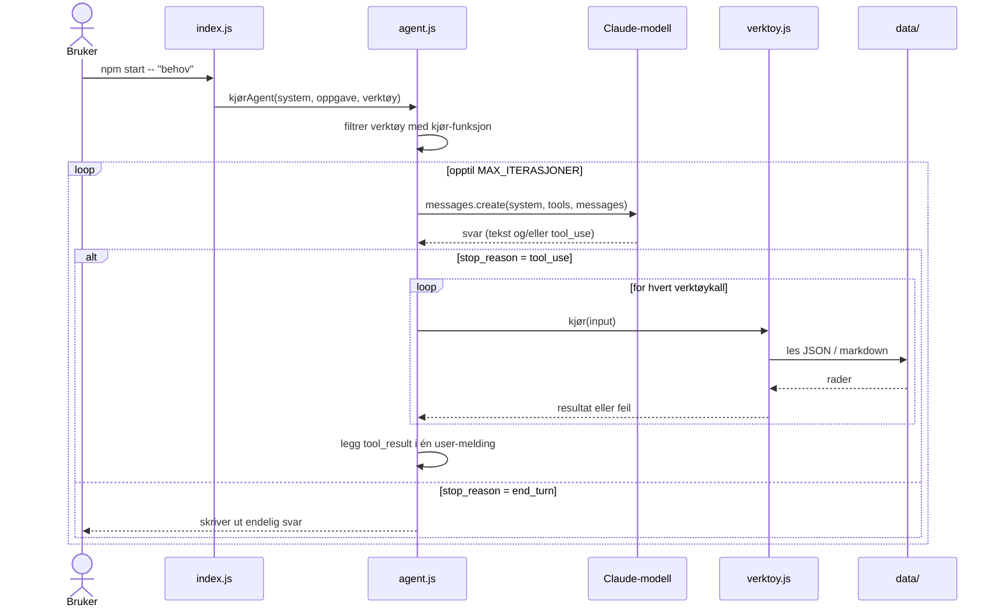
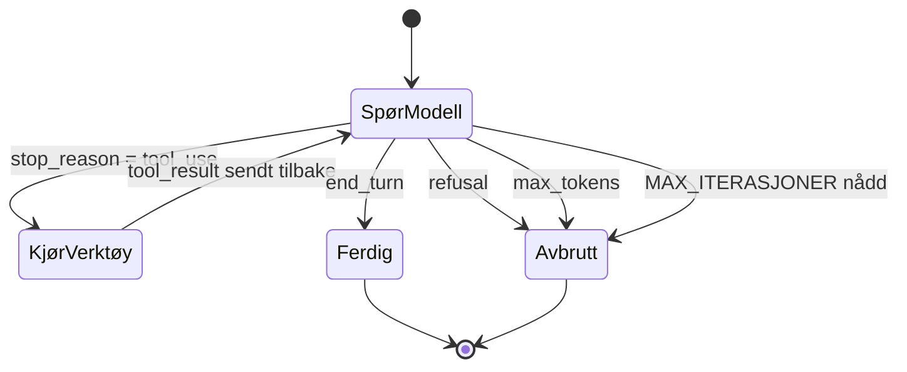
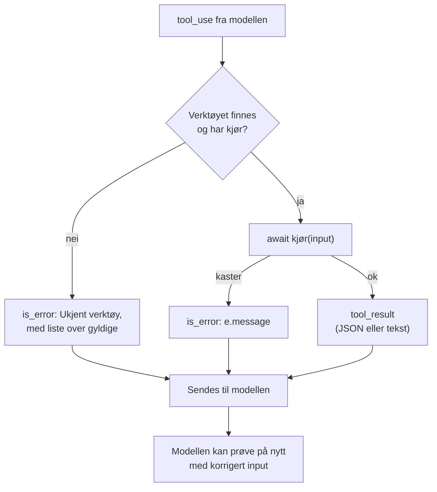

# Agentløkka

Implementert i `kjørAgent` i [agent.js](../src/agent.js). Mønsteret: spør modellen, kjør verktøyene den ber om, send resultatene tilbake, gjenta til den er ferdig.

## Sekvens

## Tilstandsmaskin

## Stoppbetingelser

| Betingelse | Resultat |
|---|---|
| `end_turn` | Modellen er ferdig. Svaret skrives ut |
| `refusal` | Modellen avslo. Kategorien vises hvis den finnes |
| `max_tokens` | Svaret ble kuttet |
| `MAX_ITERASJONER` | Agenten gikk i ring. Løkka stopper med en melding |

## Verktøyfeil

Feilmeldingen er det modellen ser, så den bør forklare hva som var galt og hva den kan gjøre i stedet.

## Detaljer å vite om

- Modellen kan be om flere verktøy i samme svar. Alle resultatene må sendes tilbake i én og samme melding.
- Tekst som kommer sammen med et verktøykall vises i grått. Endelig svar vises i vanlig farge.
- Hvert verktøykall logges som `→ navn {input}`, og resultatet som `✓ N tegn tilbake` eller `✖ feilmelding`.
