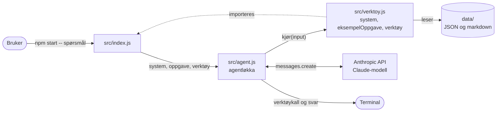
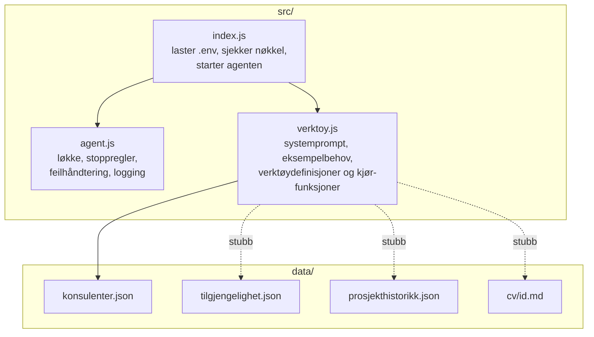

# Arkitektur

Seansen er en bemanningsagent. Brukeren stiller et spørsmål på norsk, og en Claude-modell slår opp i datafiler via verktøy før den svarer med en rangert kandidatliste.

## Oversikt

## Filene

Heltrukne piler er implementert. Stiplede piler er stubber som ennå ikke har en `kjør`-funksjon.

## Ansvarsdeling

| Fil | Ansvar | Endres når |
|---|---|---|
| [index.js](../src/index.js) | Oppstart, miljøvariabler, leser spørsmålet fra kommandolinjen | Sjelden |
| [agent.js](../src/agent.js) | Generisk løkke som ikke vet noe om bemanning | Sjelden |
| [verktoy.js](../src/verktoy.js) | Domenet: prompt, verktøy og datatilgang | Hele tiden |

Agentløkka er bevisst atskilt fra domenet. Du bytter ut `verktoy.js` for å lage en annen type agent.

## Konfigurasjon

| Variabel | Standard | Effekt |
|---|---|---|
| `ANTHROPIC_API_KEY` | (påkrevd) | Nøkkel til API-et. Settes i `.env` eller i miljøet |
| `MODELL` | `claude-sonnet-5-5` | Modellen agenten bruker |
| `MAX_ITERASJONER` | `10` | Maks antall runder før løkka stopper |

`.env` står i `.gitignore` og skal ikke committes.

Se også [agentlokke.md](agentlokke.md), [verktoy.md](verktoy.md) og [datamodell.md](datamodell.md).
