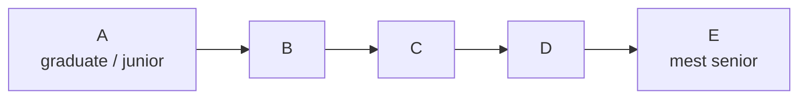

# Datamodellen

All data er syntetisk og ligger i [data/](../data/). 80 konsulenter kobles på `id` (f.eks. `k007`) på tvers av filene.

```mermaid
erDiagram
    KONSULENT ||--o{ KOMPETANSE : har
    KONSULENT ||--o| TILGJENGELIGHET : "har status"
    KONSULENT ||--o| PROSJEKTHISTORIKK : "har historikk"
    KONSULENT ||--o| CV : "kan ha"
    PROSJEKTHISTORIKK ||--o{ PROSJEKT : inneholder
    TILGJENGELIGHET ||--o| OPPDRAG : "nåværende"

    KONSULENT {
        string id PK
        string navn
        string grad "A til E"
        string rolle
        string avdeling
        string lokasjon
        string[] sertifiseringer
        string[] språk
    }
    KOMPETANSE {
        string ferdighet
        int nivå "1 til 5, selvvurdert"
    }
    TILGJENGELIGHET {
        string id FK
        date ledig_fra
        int ledig_prosent
    }
    OPPDRAG {
        string kunde
        string rolle
        date til
    }
    PROSJEKTHISTORIKK {
        string konsulent_id FK
    }
    PROSJEKT {
        string kunde
        string bransje
        int år
        string rolle
        string[] teknologier
    }
    CV {
        string fil "cv/id.md"
    }
```

## Filene

| Fil | Nøkkel | Innhold |
|---|---|---|
| `konsulenter.json` | `id` | Profil og kompetanse for alle 80 |
| `tilgjengelighet.json` | `id` | Nåværende oppdrag, ledig fra-dato og ledig prosent |
| `prosjekthistorikk.json` | `konsulent_id` | Liste over tidligere prosjekter |
| `cv/<id>.md` | filnavn | Kort CV-sammendrag. Bare ca. 20 konsulenter har en |

Nøkkelnavnet er ikke likt overalt: `id` i to filer og `konsulent_id` i prosjekthistorikken.

## Grad

Antakelsen står i `system`-prompten og i verktøybeskrivelsen. Stemmer den ikke med virkeligheten, må begge steder rettes.

## Kjente svakheter

- CV og profil sier ikke alltid det samme. Agenten er bedt om å si fra når de spriker.
- Nivå er selvvurdert og kan ikke sammenlignes helt mellom personer.
- Juniorer har ofte ingen prosjekthistorikk.
- Bare en del av konsulentene har CV, så `hent_cv` må tåle at filen mangler.
