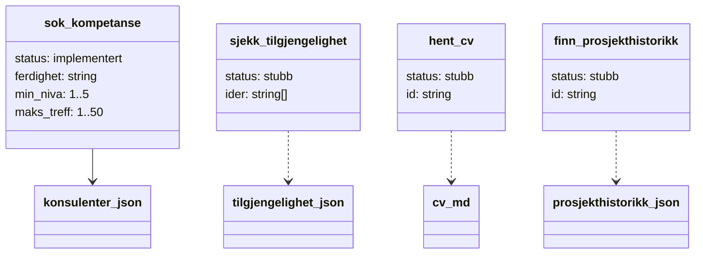
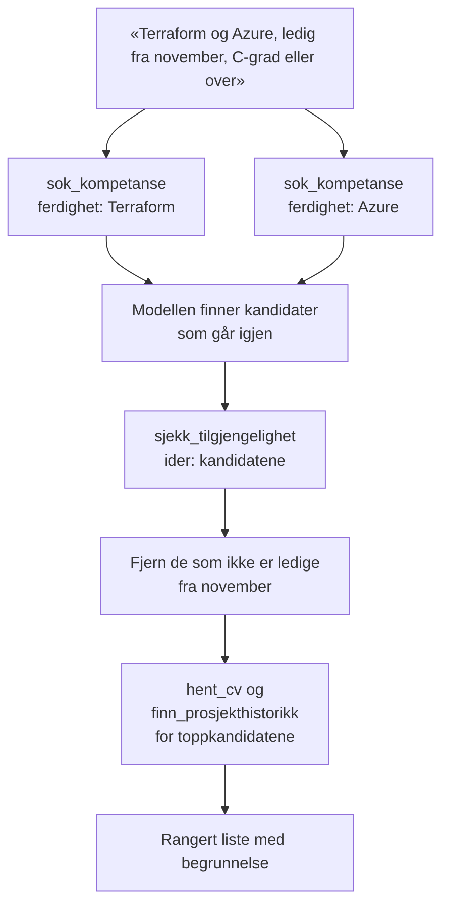

# Verktøyene

Definert i [verktoy.js](../src/verktoy.js). Hvert verktøy består av to deler:

- `definisjon`: navn, beskrivelse og `input_schema`. Dette er det modellen leser.
- `kjør`: funksjonen som faktisk gjør jobben. `null` betyr stubb, og verktøyet sendes da ikke til modellen.

## Oversikt

## Typisk bruk for et behov

Rekkefølgen er modellens valg. Diagrammet viser bare det naturlige forløpet.

## Status og hva som gjenstår

| Verktøy | Input | Returnerer | Å tenke på ved implementering |
|---|---|---|---|
| `sok_kompetanse` | ferdighet, min_niva, maks_treff | Treff sortert på høyeste nivå, med matchende ferdigheter | Delvis match på navn, uavhengig av store og små bokstaver |
| `sjekk_tilgjengelighet` | liste med id-er | Oppdrag, `ledig_fra`, `ledig_prosent` per id | Ukjente id-er og tom liste |
| `hent_cv` | id | CV som markdown, eller tekst om at den mangler | Bare ca. 20 har CV. Valider id mot `k\d{3}` så ingen leser filer utenfor `data/cv/` |
| `finn_prosjekthistorikk` | id | Tidligere prosjekter | Vurder søk på teknologi eller bransje på tvers av alle |

## Legge til et verktøy

1. Legg en ny oppføring i `verktøy`-listen i `verktoy.js` med `definisjon` og `kjør`.
2. Skriv beskrivelsen som til en ny kollega: hva verktøyet gjør, hva det ikke gjør og hva det returnerer.
3. Kast en `Error` med en forklarende melding ved ugyldig input. Modellen får den tilbake og kan korrigere.
4. Oppdater `system`-prompten hvis verktøyet endrer hvordan agenten bør jobbe.

Ingen endringer trengs i `agent.js`.
